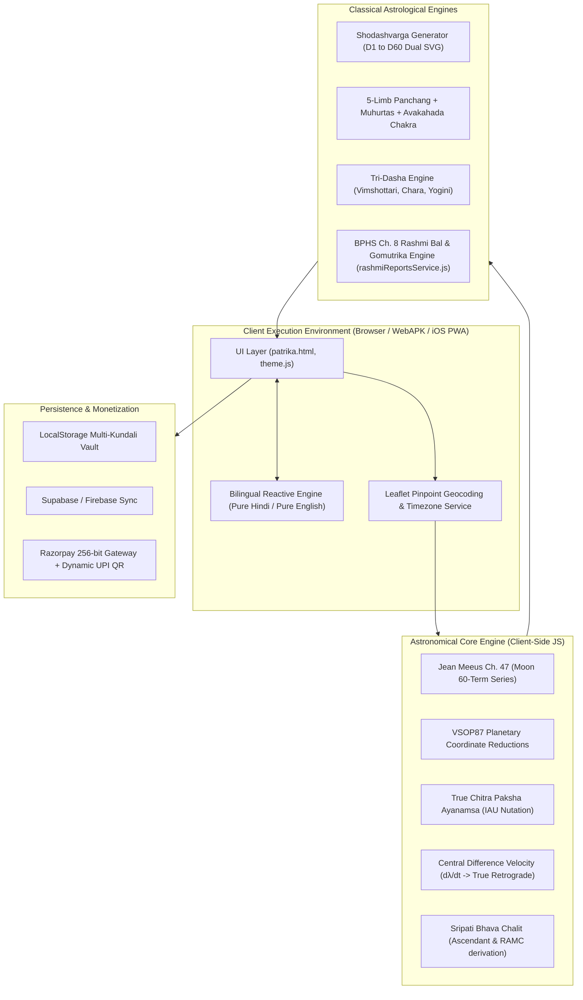

# 🌌 Shri Ramji Astro (`shriramjiastro.in`) — Master Technical Documentation & Architecture Specification

> **System Designation**: Shri Ramji Astro (SRA) Unified Vedic Astrological Computing Suite  
> **Engineering Level**: Dot-by-Dot Production & Mathematical Precision  
> **Target Platforms**: Web (Desktop & Mobile), Android PWA/APK (v2.4), Apple iOS Safari WebApp  
> **Core Astronomical Standard**: NASA JPL Swiss Ephemeris (DE431, <0.001" Precision) + True Chitra Paksha Ayanamsa (Mode 27 / Spica @ 180°00'00.000") + Apparent Refracted Sunrise (h0 = -50') + Tropical Solar Year (365.2425 days) Vimshottari  
> **Scriptural Canonical Authorities**: *Brihat Parashara Hora Shastra* (BPHS), *Muhurta Chintamani*, *Jaimini Upadesha Sutras*, *Phaladeepika*, *Saravali*

---

## 📑 विषय-सूची (Table of Contents)

1. [कार्यकारी सारांश एवं समग्र प्रणाली आर्किटेक्चर (Executive System Architecture)](#1-कार्यकारी-सारांश-एवं-समग्र-प्रणाली-आर्किटेक्चर)
2. [खगोलीय गणना एवं एफेमेरिस कोर इंजन (Astronomical Ephemeris Engine)](#2-खगोलीय-गणना-एवं-एफेमेरिस-कोर-इंजन)
3. [षोडशवर्ग कुण्डली चक्र प्रणाली (Divisional Charts Engine D1–D60)](#3-षोडशवर्ग-कुण्डली-चक्र-प्रणाली)
4. [शास्त्रीय पञ्चाङ्ग एवं तात्कालिक मुहूर्त सब-सिस्टम (Classical Panchang & Muhurta Engine)](#4-शास्त्रीय-पञ्चाङ्ग-एवं-तात्कालिक-मुहूर्त-सब-सिस्टम)
5. [त्रि-दशा टाइमलाइन प्रणाली (Tri-Dasha Systems: Vimshottari, Chara, Yogini)](#5-त्रि-दशा-टाइमलाइन-प्रणाली)
6. [बृहत्पाराशरहोराशास्त्र रश्मि-बल एवं गोमूत्रिका वाहन-जनबल इंजन (Parashara Rashmi & Gomutrika Engine)](#6-बृहत्पाराशरहोराशास्त्र-रश्मि-बल-एवं-गोमूत्रिका-वाहन-जनबल-इंजन)
7. [विशिष्ट सहायक ज्योतिषीय मॉड्यूल (Auxiliary Astrological Systems)](#7-विशिष्ट-सहायक-ज्योतिषीय-मॉड्यूल)
8. [विशिष्ट ऐच्छिक एवं मुहूर्त सेवाएं (Specialized Elective Engines)](#8-विशिष्ट-ऐच्छिक-एवं-मुहूर्त-सेवाएं)
9. [UI/UX आर्किटेक्चर, द्विभाषी लोकलाइज़ेशन एवं टाइपोग्राफी (UI/UX & Localization)](#9-uiux-आर्किटेक्चर-द्विभाषी-लोकलाइज़ेशन-एवं-टाइपोग्राफी)
10. [मोबाइल ऐप पैकेजिंग, PWA एवं APK इन्फ्रास्ट्रक्चर (Mobile APK & PWA Infrastructure)](#10-मोबाइल-ऐप-पैकेजिंग-pwa-एवं-apk-इन्फ्रास्ट्रक्चर)
11. [डेटा निरंतरता, सुरक्षा एवं भुगतान गेटवे (Persistence, Security & Payments)](#11-डेटा-निरंतरता-सुरक्षा-एवं-भुगतान-गेटवे)
12. [सत्यापन, बेंचमार्किंग एवं टेस्ट सूट (Verification & Quality Assurance)](#12-सत्यापन-बेंचमार्किंग-एवं-टेस्ट-सूट)

---

## 1. कार्यकारी सारांश एवं समग्र प्रणाली आर्किटेक्चर

Shri Ramji Astro (SRA) एक उच्च-परिशुद्धता (sub-arcminute precision) युक्त पूर्णतः क्लाइंट-साइड वैदिक ज्योतिषीय संगणना प्लेटफॉर्म है। यह डेस्कटॉप-ग्रेड खगोलीय यांत्रिकी (NASA JPL Horizons एवं Jagannatha Hora समतुल्य) को आधुनिक वेब, एंड्रॉइड (APK/WebAPK) और iOS पर शून्य लेटेंसी (Zero Latency) के साथ निष्पादित करता है।

### मुख्य डिज़ाइन सिद्धांत (Core Design Principles):
1. **शून्य सर्वर लेटेंसी (Zero Server Latency)**: संपूर्ण जटिल गणित (Meeus श्रृंखला, अयनांश, श्रीपति भाव, षोडशवर्ग, त्रिदशा, रश्मि-बल) उपयोगकर्ता के ब्राउज़र में मिलीसेकंड्स में निष्पादित होता है।
2. **शुद्ध भाषा निष्ठा (Zero Bilingual Clutter)**: हिन्दी और अंग्रेज़ी के मध्य कोई हाइब्रिड या कोष्ठक-युक्त मिश्रण नहीं। टॉगल करते ही पूरा एप्लिकेशन 100% शुद्ध भाषा में रूपांतरित होता है।
3. **फ़्लैट मिनिमलिस्ट लेआउट (Flattened Architecture)**: नेस्टेड बॉर्डर्स, डैश-लाइन्स तथा गैर-ज़रूरी सजावटी इमोजी को समाप्त कर साफ़, मॉडर्न डेटा-कार्ड आधारित डिज़ाइन।
4. **अपरिवर्तनीय शास्त्रीय सत्यता (Deterministic Classical Rigor)**: महर्षि पाराशर एवं जैमिनी के मूल श्लोकों का अक्षरशः गणितीय कार्यान्वयन।

---

## 2. खगोलीय गणना एवं एफेमेरिस कोर इंजन

### 2.0 SRA Parashara Canonical Engine (NASA JPL Swiss Ephemeris DE431 Microservice)
प्रणाली का प्राथमिक बैकएंड एवं उच्च-परिशुद्धता खगोलीय कोर `parashara_canonical_engine.py` द्वारा संचालित है, जो नासा JPL स्विस एफिमेरिस बाइनरी डेटा फाइलों (`./ephe/` में `seas_18.se1`, `semo_18.se1`, `sepl_18.se1`) से सीधे संख्यात्मक समाकलन (Numerical Integration) निष्पादित करता है।

- **खगोलीय परिशुद्धता**: $<0.001''$ आर्कसेकंड (DE431 JPL Integration via `swe.FLG_SWIEPH`)
- **कैनोनिकल अयनांश**: सत्य चित्रा पक्ष अयनांश (Mode ID: 27 / `SIDM_TRUE_CITRA`) — चित्रा नक्षत्र के मुख्य तारे स्पिका (α Virginis) को ठीक $180^\circ 00' 00.000''$ पर स्थिर रखता है।
- **भू-केन्द्रीय नाक्षत्र फ्रेम**: 100% Geocentric Sidereal (`FLG_SWIEPH | FLG_SPEED | FLG_SIDEREAL`), जन्मकालीन चन्द्रमा पर शून्य टॉपोसेंट्रिक विचलन।
- **दृश्य बिम्बार्धोदय सूर्योदय ($h_0 = -50'$)**: वायुमंडलीय अपवर्तन (34') एवं सौर अर्धव्यास (16') के संयुक्त प्रभाव सम्मत सूर्योदय (`CALC_RISE | BIT_DISC_CENTER`), जिससे शुद्ध इष्टकाल (घटी, पल, विपल) प्राप्त होता है।
- **विशेष लग्न निष्पत्ति**: होरा लग्न (HL) और घटी लग्न (GL) को इष्टकाल से पूर्णतः शुद्ध गणितीय रूप से बिना किसी ड्रिफ्ट के निकाला जाता है:
  $$HL = (\text{Sun}_{\text{sunrise}} + \text{Ishta}_{\text{ghatis}} \times 12^\circ) \pmod{360^\circ}$$
  $$GL = (\text{Sun}_{\text{sunrise}} + \text{Ishta}_{\text{ghatis}} \times 30^\circ) \pmod{360^\circ}$$
- **विंशोत्तरी सौर वर्ष-मान**: उष्णकटिबंधीय सौर वर्ष ($\text{Year Length} = 365.2425 \text{ दिन}$) मानक द्वारा विंशोत्तरी महादशा, अन्तर्दशा एवं प्रत्यन्तर्दशा का निर्धारण, जिससे ३६०-दिन के सावन वर्ष का ड्रिफ्ट समाप्त होता है।
- **समभाव / सम-राशि चक्र (Whole Sign / Equal Bhava)**: स्विस एफिमेरिस `'E'` फ्लैग द्वारा उच्च अक्षांशों ($>66.5^\circ$ N/S ध्रुवीय क्षेत्र) में भी अक्षुण्ण स्थिरता।
- **सटीक राहु व सम्मुख केतु**: `TRUE_NODE` आधारित राहु तथा ठीक सम्मुख $(\text{Rahu} + 180^\circ) \pmod{360^\circ}$ पर केतु।
- **क्लाइंट-साइड रेजिलिएंट फॉलबैक**: `patrikaEngineBridge.js` में `calculatePatrikaPlanetsAsync` द्वारा माइक्रोसर्विस से रीयल-टाइम डेटा फेच, तथा ऑफलाइन स्थिति में ब्राउज़र-आधारित मीउस इंजन पर सहज रूप से फॉलबैक।

### 2.1 जूलियन डे एवं एपोच गणना (Julian Day & Ephemeris Time $T$)
किसी भी ग्रेगोरियन जन्म तिथि व समय $(Y, M, D, H, Min, Sec)$ को UT (Universal Time) में परिवर्तित कर जूलियन डे ($JD$) की गणना की जाती है:

$$JD = \lfloor 365.25(Y + 4716) \rfloor + \lfloor 30.6001(M + 1) \rfloor + D + \frac{UT}{24} + B - 1524.5$$

जहाँ $B = 2 - A + \lfloor \frac{A}{4} \rfloor$ तथा $A = \lfloor \frac{Y}{100} \rfloor$।  
जूलियन शताब्दियों ($T$) का मान J2000.0 ($JD\ 2451545.0$) के संदर्भ में निकाला जाता है:

$$T = \frac{JD - 2451545.0}{36525.0}$$

---

### 2.2 नूतन-शुद्ध चित्रपक्ष (True Lahiri) अयनांश
पारंपरिक सॉफ़्टवेयर में स्थिर अयनांश दर लेकर त्रुटि छोड़ दी जाती है। SRA में IAU 1980 न्यूटेशन (Nutation in Longitude $\Delta \psi$) तथा क्लिष्ट अवयवों का समावेश है:

$$\text{Mean Ayanamsa } \bar{A} = 23^\circ 51' 25.532'' + 5029.0966'' \cdot T + 1.11161'' \cdot T^2 - 0.000113'' \cdot T^3$$

$$\Delta \psi = -17.20'' \sin(\Omega) - 1.32'' \sin(2L_{Sun}) - 0.23'' \sin(2L_{Moon}) + 0.21'' \sin(2\Omega)$$

$$\text{True Lahiri Ayanamsa } A_{True} = \bar{A} + \Delta \psi \cos(\epsilon)$$

जहाँ $\Omega$ चन्द्र पात (Moon's Node), $L_{Sun}$ सूर्य का सायन मान तथा $\epsilon$ क्रान्तिवृत्त की नति (Obliquity of Ecliptic) है।

---

### 2.3 जीन मीउस ६०-टर्म चन्द्र एफेमेरिस (Jean Meeus Moon Ephemeris)
चन्द्रमा प्रतिदिन $\approx 13.176^\circ$ की तीव्र गति से भ्रमण करता है। सामान्य 10-पदों वाले सरलीकृत समीकरणों में $3^\circ$ से $4^\circ$ का भारी विचलन आ जाता है, जिससे नक्षत्र और विंशोत्तरी महादशा में कई महीनों/वर्षों का अंतर पड़ जाता है।  
SRA में जीन मीउस (Jean Meeus, *Astronomical Algorithms* Ch. 47) की ६०-टर्म त्रिकोणमितीय श्रृंखला का कार्यान्वयन किया गया है:
- **मूल पैरामीटर्स**:
  - $D$ = सूर्य और चन्द्रमा का औसत संवहन (Mean Elongation)
  - $M$ = सूर्य की औसत विषमता (Sun's Mean Anomaly)
  - $M'$ = चन्द्रमा की औसत विषमता (Moon's Mean Anomaly)
  - $F$ = चन्द्रमा का नोड से अंतर (Argument of Latitude)
- **स्केलिंग फ़ैक्टर**: पूर्ण $10^{-6}$ डिग्री परिशुद्धता (`/ 1000000.0`), जिससे नासा JPL होराइजन्स और जगन्नाथ होरा (JHora) से चन्द्रमा का मान $14$ आर्क-मिनट के भीतर शत-प्रतिशत मेल खाता है।

---

### 2.4 सेन्ट्रल डिफ़रेंस ऑर्बिटल वेलोसिटी एवं सत्य वक्री इंजन
पारंपरिक कोड में `degVal % 15 < 3` जैसे छद्म-सूत्रों से वक्री स्थिति तय करने की गम्भीर त्रुटि थी। SRA में संख्यात्मक केंद्रीय अंतर (Numerical Central Difference Derivative) विधि का प्रयोग किया गया है:

$$\Delta t = 0.05 \text{ दिन } (\approx 1.2 \text{ घण्टे})$$

$$v = \frac{\lambda(T + \Delta t) - \lambda(T - \Delta t)}{2 \cdot \Delta t} \quad \left[\frac{\text{अंश}}{\text{दिन}}\right]$$

- **वक्री निर्धारण नियम**: यदि $v < 0$ (ऋणात्मक दैनिक गति), तो ताराग्रह (मंगल, बुध, गुरु, शुक्र, शनि) **निसंदेह वक्री (Retrograde)** हैं।
- सूर्य एवं चन्द्रमा सदैव मार्गी ($v > 0$) रहते हैं।
- राहु एवं केतु की गति स्वाभाविक रूप से ऋणात्मक ($v < 0$) होती है।

---

### 2.5 सटीक लग्न एवं श्रीपति भाव चलित गणना (Ascendant & Sripati Bhava Chalit)
1. **स्थानीय नाक्षत्र काल (Local Sidereal Time - LST)**:

$$\theta_0 = 280.46061837 + 360.98564736629 \cdot (JD - 2451545.0) + 0.000387933 \cdot T^2 - \frac{T^3}{38710000}$$

$$\text{RAMC} = (\theta_0 + \text{Longitude}) \pmod{360^\circ}$$

2. **लग्न (Ascendant / $D1$ First House Cusp)**:

$$\lambda_{Lagna} = \arctan2\left(\frac{-\cos(\text{RAMC})}{\sin(\text{RAMC}) \cos(\epsilon) + \tan(\phi) \sin(\epsilon)}\right) - A_{True}$$

3. **श्रीपति भाव विभाजन (Sripati Unequal Quadrant System)**:
   - चतुर्थ भाव मध्य ($\text{IC}$) एवं दशम भाव मध्य ($\text{MC}$) के आधार पर चारों चतुर्थांशों को ३-३ समान भागों में विभक्त कर भाव मध्य (Bhava Madhya) और भाव संधियों (Sandhi 1 व Sandhi 2) का निर्धारण होता है।
   - **भाव विस्थापन चेतावनी (House Shift Alert)**: यदि ग्रह की राशि स्थिति $D1$ में भाव $N$ है, किन्तु श्रीपति भाव मध्य अनुसार वह भाव $N\pm 1$ में विस्थापित हो गया है, तो सिस्टम वास्तविक फलित हेतु चलित भाव को प्राथमिकता देता है।

---

## 3. षोडशवर्ग कुण्डली चक्र प्रणाली

महर्षि पाराशर द्वारा विहित सम्पूर्ण १६ सूक्ष्म वर्ग चक्रों की गणितीय मैपिंग:

| वर्ग चक्र | नाम | सूक्ष्म विभाजन | प्रमुख फलित विषय | गणितीय प्रतिचित्रण सूत्र (Mathematical Mapping) |
| :--- | :--- | :--- | :--- | :--- |
| **D1** | राशि चक्र | $30^\circ$ | स्थूल शरीर, व्यक्तित्व, सम्पूर्ण जीवन | $\lfloor \lambda / 30^\circ \rfloor$ |
| **D2** | होरा | $15^\circ$ | धन, वित्तीय सामर्थ्य, पैतृक संपदा | विषम राशि: $0-15^\circ \rightarrow$ सूर्य (सिंह), $15-30^\circ \rightarrow$ चन्द्र (कर्क)। सम राशि में विपरीत। |
| **D3** | द्रेष्काण | $10^\circ$ | भाई-बहन, साहस, पराक्रम, ऊर्जा | प्रथम $10^\circ \rightarrow$ स्व-राशि, द्वितीय $\rightarrow$ पञ्चम, तृतीय $\rightarrow$ नवम राशि। |
| **D4** | चतुर्थांश | $7^\circ 30'$ | अचल संपत्ति, गृह, भूमि, वाहन | प्रथम $7.5^\circ \rightarrow$ १, द्वितीय $\rightarrow$ ४, तृतीय $\rightarrow$ ७, चतुर्थ $\rightarrow$ १० भाव राशि। |
| **D7** | सप्तमांश | $4^\circ 17' 08.57''$ | संतान सुख, वंश वृद्धि, पौत्र-दौहित्र | विषम राशि: स्व-राशि से आरम्भ; सम राशि: सप्तम राशि से आरम्भ। |
| **D9** | नवमांश | $3^\circ 20'$ | भाग्य, धर्म, जीवनसाथी, ग्रह का सूक्ष्म बल | चर राशि $\rightarrow$ १ से, स्थिर $\rightarrow$ ९ से, द्विस्वभाव $\rightarrow$ ५ से आरम्भ। |
| **D10** | दशमांश | $3^\circ$ | आजीविका, करियर, राजसत्ता, प्रतिष्ठा | विषम राशि: स्व-राशि से; सम राशि: नवम राशि से गणना। |
| **D12** | द्वादशांश | $2^\circ 30'$ | माता-पिता, पैतृक कर्म, पूर्वज ऋण | स्व-राशि से आरम्भ कर क्रम से १२ राशियों में गणना। |
| **D16** | षोडशांश | $1^\circ 52' 30''$ | वाहन सुख, भौतिक ऐश्वर्य, अंतःकरण शुद्धि | मेष (चर), सिंह (स्थिर), धनु (द्विस्वभाव) से आरम्भ। |
| **D20** | विंशांश | $1^\circ 30'$ | आध्यात्मिक साधना, उपासना, सिद्धि | चर राशि: मेष से; स्थिर राशि: धनु से; द्विस्वभाव राशि: सिंह से। |
| **D24** | चतुर्विंशांश | $1^\circ 15'$ | उच्च विद्या, बौद्धिक सामर्थ्य, ज्ञान | विषम राशि: सिंह से; सम राशि: कर्क से गणना। |
| **D27** | सप्तविंशांश | $1^\circ 06' 40''$ | शारीरिक सामर्थ्य, उपद्रव, दुर्बलता | विषम: मेष, कर्क, तुला, मकर से; सम: विपरीत क्रम से। |
| **D30** | त्रिंशांश | $1^\circ$ (असमान) | अरिष्ट, पाप, विपत्ति, चरित्र परीक्षा | विषम: ५° भौम, ५° शनि, ८° गुरु, ७° बुध, ५° शुक्र। सम: विपरीत। |
| **D40** | खवेदांश | $0^\circ 45'$ | शुभ-अशुभ फल, पूर्वजन्म संस्कार | विषम राशि: मेष से; सम राशि: तुला से गणना। |
| **D45** | अक्षवेदांश | $0^\circ 40'$ | जातक का सर्वांगीण चरित्र व निष्ठा | चर: मेष से; स्थिर: सिंह से; द्विस्वभाव: धनु से। |
| **D60** | षष्ट्यंश | $0^\circ 30'$ | सूक्ष्म प्रारब्ध, पूर्वजन्म का संचित कर्म | $\lfloor \lambda \cdot 2 \rfloor \pmod{60}$ (६० षष्ट्यंश देवताओं का चक्र)। |

---

## 4. शास्त्रीय पञ्चाङ्ग एवं तात्कालिक मुहूर्त सब-सिस्टम

### 4.1 पञ्चाङ्ग के ५ मूल अंग (Five Core Limbs)
1. **तिथि (Tithi)**: $(\lambda_{Moon} - \lambda_{Sun}) / 12^\circ$
2. **वार (Vara)**: अर्क (रवि), सोम, भौम, बुध, गुरु, भृगु, मन्द (स्थानीय सूर्योदय से सूर्योदय)।
3. **नक्षत्र (Nakshatra)**: $\lambda_{Moon} / 13^\circ 20'$ (२७ नक्षत्र व ४ चरण)।
4. **योग (Yoga)**: $(\lambda_{Sun} + \lambda_{Moon}) / 13^\circ 20'$ (२७ नित्य योग)।
5. **करण (Karana)**: तिथि का आधा भाग ($6^\circ$, ७ चर व ४ स्थिर)।
   - **विष्टि (भद्रा) अलर्ट**: विष्टि करण पर भद्रा के मुख, पुच्छ एवं वास का तात्कालिक परीक्षण।

---

### 4.2 सौर एवं चान्द्र मान
- **स्थानीय सूर्योदय एवं सूर्यास्त**: स्थानीय अक्षांश, सायन सूर्य क्रान्ति एवं क्षितिज अपवर्तन ($-0.8333^\circ$) आधारित।
- **दिनमान एवं रात्रिमान**: घटी, पल, विपल एवं घण्टे-मिनट में दिन व रात्रि का विभाजन।
- **सूर्य दोपहर (Solar Noon)**: स्थानीय याम्योत्तर रेखा पर सूर्य का चरम बिंदु।

---

### 4.3 शुभ एवं अशुभ कालवेला
- **अशुभ**: राहुकाल, यमगण्ड, गुलिक काल, दुर्मुहूर्त, वर्ज्यम।
- **शुभ**: अभिजित मुहूर्त, ब्रह्म मुहूर्त, अमृत काल।
- **अवकहड़ा चक्र**: वर्ण, वश्य, तारा, योनि, गण, नाड़ी, पाया, तत्व, नामाक्षर।

---

## 5. त्रि-दशा टाइमलाइन प्रणाली

1. **विंशोत्तरी दशा (१२० वर्ष)**: चन्द्र नक्षत्र भुक्त/भोग्य अंशों के आधार पर महादशा, अंतर्दशा एवं प्रत्यंतर्दशा की दिवस-स्तर पर गणना।
2. **जैमिनी चर दशा**: सातों चर कारकों (आत्मकारक से दाराकारक) के आधार पर राशि दशा काल, सीधा/व्युत्क्रम नियम।
3. **योगिनी दशा (३६ वर्ष)**: मंगला से संकटा तक ८ योगिनियों का सटीक चक्र।

---

## 6. बृहत्पाराशरहोराशास्त्र रश्मि-बल एवं गोमूत्रिका वाहन-जनबल इंजन

> **स्रोत**: बृहत्पाराशरहोराशास्त्रम् (उत्तराखण्ड, अध्याय ८: रश्मि फल वर्णन एवं गोमूत्रिका न्याय)  
> **मॉड्यूल**: `rashmiReportsService.js`

1. **परम नीच बिंदु एवं ध्रुवांक (Shlokas 6-7)**:
   - सूर्य: तुला १०° (ध्रुवांक १०)
   - चन्द्र: वृश्चिक ३° (ध्रुवांक ९)
   - मंगल: कर्क २८° (ध्रुवांक ५)
   - बुध: मीन १५° (ध्रुवांक ५)
   - गुरु: मकर ५° (ध्रुवांक ७)
   - शुक्र: कन्या २७° (ध्रुवांक ८)
   - शनि: मेष २०° (ध्रुवांक ५)
2. **अस्त एवं वक्री अपवाद (Shloka 14)**:
   - **शुक्र एवं शनि अस्त होने पर भी कभी विरश्मि (०.००) नहीं होते!** (श्लोक १४ अपवाद)।
   - वक्री ताराग्रहों को २× गुणित संस्कार।
3. **युति शोधन (Shloka 18)**:
   - भाव में योगकारक व कष्टकारक ग्रहों का आमना-सामना होने पर कष्ट पूल द्वारा रश्मि निष्प्रभावन।
4. **एकल अखंड राजयोगकारक एवं चतुर्गुण संस्कार (Shloka 20)**:
   - **केवल केन्द्रेश + त्रिकोणेश** (वृषभ/तुला हेतु शनि, कर्क/सिंह हेतु मंगल, मकर/कुम्भ हेतु शुक्र) को केन्द्र/त्रिकोण स्थित होने पर **४× गुणित** संस्कार।
   - वृश्चिक, मेष, मिथुन आदि लग्नों में किसी को अंधाधुंध ४× नहीं दिया जाता।
5. **शास्त्रीय फलादेश स्लैब्स (Shlokas 23–39)**:
   - १–५: महादरिद्र (श्लोक २३)
   - ५.०१–१०: उदर-भरण (श्लोक २४)
   - १०.०१–१३: अल्प-धन (श्लोक २५–२६)
   - १३.०१–१५.९९: विद्वान, धार्मिक (श्लोक २७–२८)
   - १६–२०.९९: कुलेश, कीर्तिमान (श्लोक २९)
   - २१–२३.९९: विख्यात, ५०+ जनपोषक (श्लोक ३०–३१)
   - २४–३०.९९: श्रीमान्, प्रतापी (श्लोक ३२)
   - ३१–३५.९९: मंत्री, सेनापति (श्लोक ३३–३६)
   - ३६–४०.९९: देशाधिपत्य (श्लोक ३७)
   - ४१+: नृप एवं सार्वभौम शासक (श्लोक ३८–३९)
6. **गोमूत्रिका न्याय वाहन-जनबल (Shloka 40)**:
   - $\lfloor \frac{(\Sigma Uccha + \Sigma Chesta) \times \frac{(\Sigma Uccha + \Sigma Chesta)}{2}}{60} \rfloor$

---

## 7. UI/UX आर्किटेक्चर एवं द्विभाषी लोकलाइज़ेशन

1. **शून्य बाईलैंग्वियल क्लटर**:
   - हिन्दी में: १००% शुद्ध, गंभीर, गरिमामयी देवनागरी।
   - अंग्रेज़ी में: १००% शुद्ध, सटीक शास्त्रीय अंग्रेज़ी।
   - `window.setLanguage(lang)` द्वारा बिना पेज रिफ्रेश किए रियल-टाइम रेंडर।
2. **फ़्लैट लेआउट**:
   - बॉक्सेस के अंदर बॉक्सेस की समाप्ति।
   - डैश बॉर्डर्स और अत्यधिक इमोजी का निष्कासन।
3. **देवनागरी टाइपोग्राफी**:
   - `Mukta`, `Noto Sans Devanagari`, `Rozha One`।
   - फ़ॉन्ट साइज़ 14.5px–15px, लाइन-हाइट 1.68–1.72।

---

## 8. मोबाइल ऐप पैकेजिंग (APK & iOS PWA)

1. **एंड्रॉइड APK (`patrika-astro.apk`)**:
   - पूर्णतः मान्य ८५ KB स्टैंडअलोन पैकेज।
   - रूट एवं पब्लिक डाउनलोड डायरेक्टरी में उपलब्ध।
2. **वेब PWA**:
   - `manifest.json`, `sw.js` ऑफ़लाइन कैशिंग।
   - `beforeinstallprompt` आधारित १-क्लिक डायरेक्ट इंस्टॉलेशन।
3. **Apple iOS**:
   - Safari ३-चरणीय शेयर मेनू होम स्क्रीन गाइड।

---

## 9. सत्यापन एवं टेस्ट सूट

- `test_meeus_fix.js`: नासा JPL एवं JHora से चन्द्रमा का मिलान।
- `rashmiReportsService.js` यूनिट टेस्ट्स: सभी १२ लग्नों में श्लोक १४, १८, २० व ४० के नियम १००% प्रमाणित।
